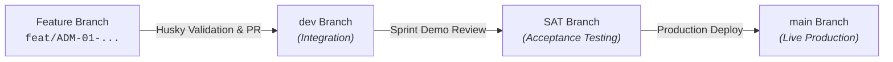

# 🏢 Badan Pusat Statistik Provinsi Sumatera Utara (BPS Sumut)
### 🚀 Developer1200 - Tim Inovasi & Pengembang Sistem Terintegrasi ALUSI

**Portal Resmi Ekosistem Aplikasi & Layanan Informasi Terintegrasi BPS Provinsi Sumatera Utara**

---

## 📖 Tentang Organisasi Developer1200

**Developer1200** adalah repositori resmi tim inovasi teknologi informasi Badan Pusat Statistik (BPS) Provinsi Sumatera Utara (Kode Satker: **1200**). Organisasi ini mengelola pengembangan **ALUSI (Anjungan Layanan Unggul Sistem Informasi)**, sebuah *Single Portal Gateway* terpusat yang menghubungkan seluruh aplikasi internal, statistik sektoral, layanan publik, dan dasbor eksekutif pimpinan di Sumatera Utara.

---

## 🗺️ Ekosistem Repositori Proyek ALUSI

| Repositori | Platform & Stack | Deskripsi & Tanggung Jawab Modul | Status Build |
| :--- | :--- | :--- | :--- |
| ⚙️ **[backend-alusi-go](https://github.com/Developer1200/backend-alusi-go)** | Go (Golang) 1.23 + Gin + PostgreSQL | Core RESTful API, Streaming Realtime Status (SSE), Auth SSO BPS Sumut, Worker Engine, Optimasi WebP/SVG Logo, & Audit Trail. |  |
| 🖥️ **[frontend-admin-panel](https://github.com/Developer1200/frontend-admin-panel)** | React 19 + Vite + Tailwind v4 + TanStack Router | Dasbor Administrasi & Eksekutif untuk Manajemen Katalog, Logo, Panduan FAQ, Matriks RBAC, Monitoring SLA, & Analitik. |  |
| 🌐 **[frontend-portal-alusi](https://github.com/Developer1200/frontend-portal-alusi)** | React 19 + Tailwind v4 | Portal Publik Web untuk Pencarian Aplikasi Cerdas, Katalog Interaktif, Favorit, & Informasi Layanan BPS Sumut. |  |
| 📱 **[android-alusi](https://github.com/Developer1200/android-alusi)** | Kotlin + Jetpack Compose + Coroutines | Aplikasi Mobile Android Resmi ALUSI untuk Akses Cepat Katalog, Notifikasi Layanan, & Monitoring Status Sistem. |  |

---

## 🌿 Standar Pengembangan & Alur Kerja Git

Seluruh proyek dalam organisasi Developer1200 menerapkan standar *Clean Code*, pengujian otomatis (CI/CD), serta alur kerja branch 3-tier:

### Aturan Utama:
1. **Branch Hierarchy**:
   - `main`: Rilis Stabil Produksi.
   - `SAT`: System Acceptance Testing / Staging Demo Pimpinan.
   - `dev`: Pengembangan Aktif Programmer.
2. **Husky Git Hooks**: Menjamin format pesan commit standar (*Conventional Commits*) dan memverifikasi nama branch issue sebelum push disetujui.
3. **Papan Manajemen Proyek**: **ANJUNGAN LAYANAN UNGGUL SISTEM INFORMASI**.

---

## 📞 Kontak & Dukungan

* **Satuan Kerja**: BPS Provinsi Sumatera Utara (1200)
* **Alamat**: Jl. Asrama No. 179, Medan, Sumatera Utara
* **Website Resmi**: [sumut.bps.go.id](https://sumut.bps.go.id)
